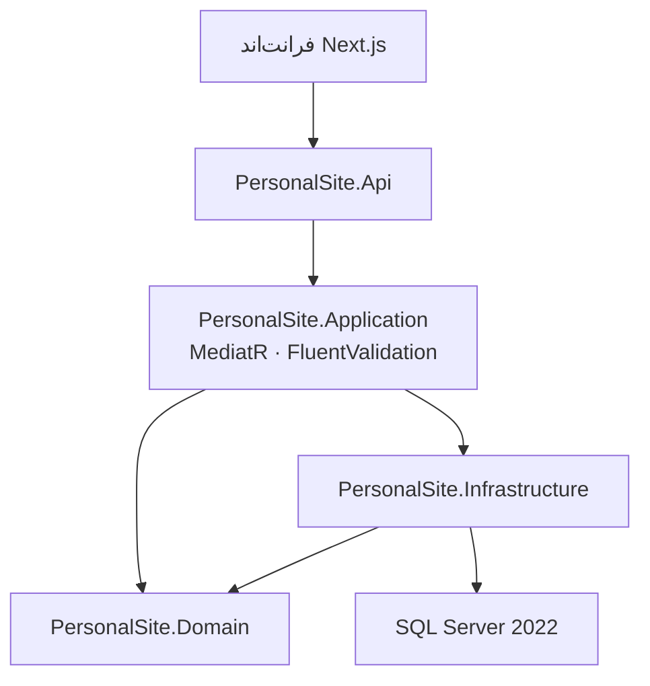

<div align="center">
  
</div>

<p align="center">
  <a href="./README.md">English</a> · <a href="./README.fa.md">فارسی</a>
</p>

<h1 align="center">سایت شخصی — بک‌اند API</h1>

<p align="center">
  API با <strong>ASP.NET Core 10</strong> و Clean Architecture برای سایت برنامه‌نویسی دوزبانه.<br />
  CQRS با MediatR، FluentValidation، EF Core، SQL Server، OpenAPI و Health Check.
</p>

<p align="center">
  <a href="https://github.com/seyedWebpro/front_personalsite"><strong>ریپوی فرانت‌اند →</strong></a>
</p>

---

## این سرویس چه می‌کند

بک‌اند عمومی [front_personalsite](https://github.com/seyedWebpro/front_personalsite) است. قوانین دامنه از HTTP، EF Core و SQL Server جدا مانده‌اند تا رشد پروژه بدون قفل شدن به فریم‌ورک ممکن باشد.

| قابلیت | توضیح |
| --- | --- |
| معماری | Clean Architecture — Domain، Application، Infrastructure، Api |
| لایه کاربرد | CQRS با MediatR و پایپ‌لاین FluentValidation |
| داده | EF Core 10، SQL Server 2022، زمان UTC، حذف نرم |
| HTTP | کنترلر، CORS، OpenAPI، پروب زنده و آماده |
| محیط محلی | Docker Compose برای SQL Server روی پورت `1434` |

## معماری



## شروع کار

### پیش‌نیاز

- [.NET SDK 10](https://dotnet.microsoft.com/download) (نسخه در `global.json`)
- [Docker Desktop](https://www.docker.com/products/docker-desktop/) برای SQL Server

### ۱. اجرای SQL Server

```bash
docker compose up -d
```

کانتینر روی **localhost:1434** گوش می‌دهد. رمز پیش‌فرض فقط برای لوکال است؛ قبل از هر محیط واقعی عوض شود.

### ۲. اجرای API

```bash
dotnet restore
dotnet run --project src/PersonalSite.Api
```

| | |
| --- | --- |
| HTTP | `http://localhost:5095` |
| HTTPS | `https://localhost:7230` |
| زنده | `GET /health/live` |
| آماده | `GET /health/ready` |
| OpenAPI | `/openapi/v1.json` در Development |

در Development اسکیما با `EnsureCreated` در اولین اجرا ساخته می‌شود.

## فرانت‌اند همراه

رابط کاربری در **[seyedWebpro/front_personalsite](https://github.com/seyedWebpro/front_personalsite)** است — Next.js 16، App Router، انگلیسی / فارسی، Tailwind CSS 4.

```bash
NEXT_PUBLIC_API_BASE_URL=http://localhost:5095
```

## مجوز

تحت [MIT License](LICENSE) منتشر شده است.
