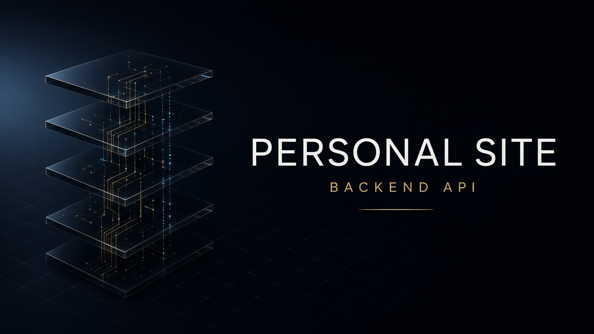
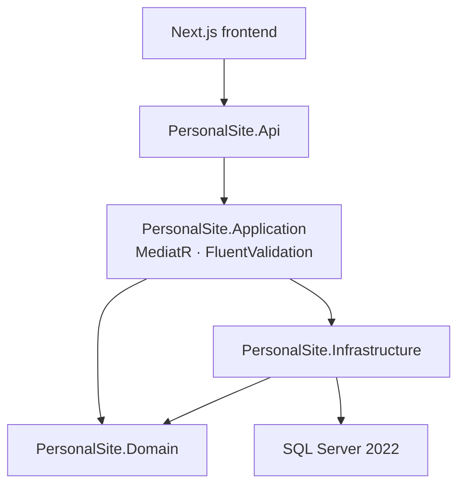

<div align="center">
  
</div>

<p align="center">
  <a href="./README.md">English</a> · <a href="./README.fa.md">فارسی</a>
</p>

<h1 align="center">Personal Site — Backend API</h1>

<p align="center">
  <strong>Clean Architecture ASP.NET Core 10 API</strong> for a bilingual personal programming site.<br />
  CQRS with MediatR, FluentValidation, EF Core, SQL Server, OpenAPI, and production-ready health checks.
</p>

<p align="center">
  <a href="https://github.com/seyedWebpro/api_backend_personalsite/actions/workflows/ci.yml"></a>
  <a href="./LICENSE"></a>
  
  
  
</p>

<p align="center">
  <a href="https://github.com/seyedWebpro/front_personalsite"><strong>Frontend repository →</strong></a>
</p>

---

## Why this API

This service is the public backend for [front_personalsite](https://github.com/seyedWebpro/front_personalsite). It is structured so domain rules stay independent of HTTP, EF Core, and SQL Server — the same shape used in serious production APIs.

| Capability | Detail |
| --- | --- |
| Architecture | Clean Architecture — Domain, Application, Infrastructure, Api |
| Application layer | MediatR CQRS + FluentValidation pipeline |
| Persistence | EF Core 10, SQL Server 2022, UTC timestamps, soft delete |
| HTTP surface | Controllers, CORS, OpenAPI, liveness & readiness probes |
| Local data | Docker Compose for SQL Server on port `1434` |

## Architecture



```
src/
├── PersonalSite.Api            HTTP, OpenAPI, CORS, health endpoints
├── PersonalSite.Application    Use cases, validation, pipeline behaviours
├── PersonalSite.Domain         Entities, domain events, shared contracts
└── PersonalSite.Infrastructure EF Core, SQL Server, Unit of Work
```

## Tech stack

- **.NET 10** / ASP.NET Core Web API
- **Entity Framework Core 10** + SQL Server
- **MediatR** and **FluentValidation**
- **OpenAPI** document in Development
- **Docker Compose** for the database
- **Health checks** at `/health/live` and `/health/ready`

## Getting started

### Prerequisites

- [.NET SDK 10](https://dotnet.microsoft.com/download) (see `global.json`)
- [Docker Desktop](https://www.docker.com/products/docker-desktop/) for SQL Server

### 1. Start SQL Server

```bash
docker compose up -d
```

The container listens on **localhost:1434**. Default local credentials match `docker-compose.yml` and `appsettings.Development.json`. Change them before any non-local use.

### 2. Run the API

```bash
dotnet restore
dotnet run --project src/PersonalSite.Api
```

| | |
| --- | --- |
| HTTP | `http://localhost:5095` |
| HTTPS | `https://localhost:7230` |
| Live | `GET /health/live` |
| Ready | `GET /health/ready` |
| OpenAPI | `/openapi/v1.json` in Development |

In Development the API calls `EnsureCreated` so the schema is created on first boot.

### Configuration

| Key | Purpose |
| --- | --- |
| `ConnectionStrings:DefaultConnection` | SQL Server connection |
| `Cors:Origins` | Allowed frontend origins (default `http://localhost:3000`) |

Prefer environment variables or user secrets over committing real passwords. `appsettings.json` ships with a placeholder `CHANGE_ME`.

## Companion frontend

The UI lives in **[seyedWebpro/front_personalsite](https://github.com/seyedWebpro/front_personalsite)** — Next.js 16, App Router, English / فارسی, Tailwind CSS 4.

Point the frontend at this API with:

```bash
NEXT_PUBLIC_API_BASE_URL=http://localhost:5095
```

## Contributing

See [CONTRIBUTING.md](CONTRIBUTING.md). Security reports go to [SECURITY.md](SECURITY.md).

## License

Released under the [MIT License](LICENSE).
